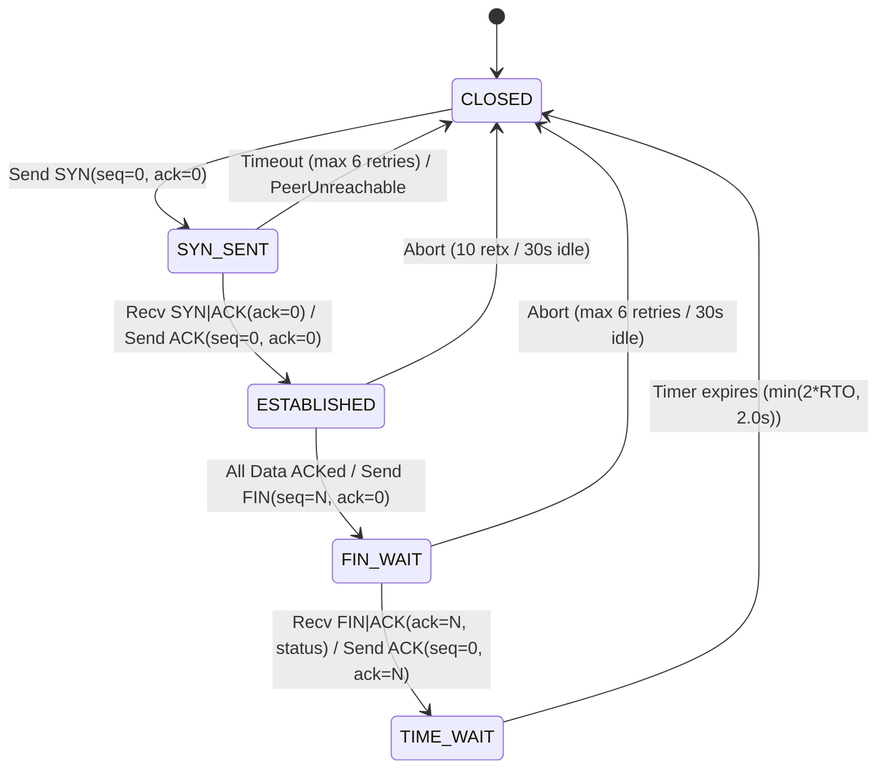
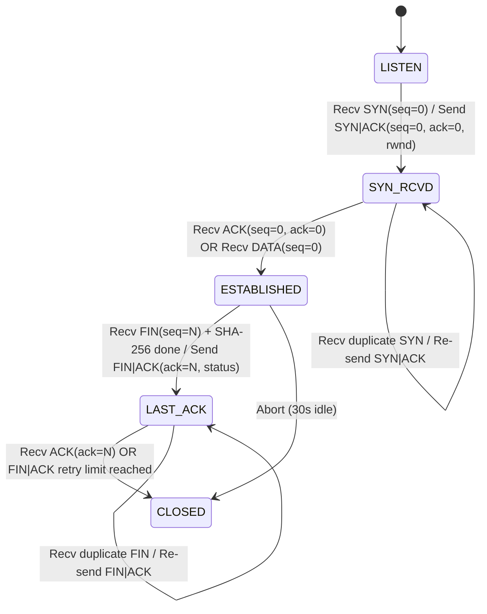

# Reliable Transport Protocol (RTP) Specification

This document provides the authoritative protocol specification for the university Computer Networks project (Project 15): Reliable Transport over UDP with Selective Repeat, Flow Control, and Congestion Control.

---

## 1. Protocol Architecture & Header Format

RTP operates directly on top of UDP datagrams. Every RTP datagram begins with an immutable **26-byte (208-bit)** header in network byte order (big-endian), followed by an optional payload of up to 1024 bytes.

### 1.1 Header Field Layout

```text
 0                   1                   2                   3
 0 1 2 3 4 5 6 7 8 9 0 1 2 3 4 5 6 7 8 9 0 1 2 3 4 5 6 7 8 9 0 1
+-+-+-+-+-+-+-+-+-+-+-+-+-+-+-+-+-+-+-+-+-+-+-+-+-+-+-+-+-+-+-+-+
|                        conn_id (32)                           |
+-+-+-+-+-+-+-+-+-+-+-+-+-+-+-+-+-+-+-+-+-+-+-+-+-+-+-+-+-+-+-+-+
|                          seq (32)                             |
+-+-+-+-+-+-+-+-+-+-+-+-+-+-+-+-+-+-+-+-+-+-+-+-+-+-+-+-+-+-+-+-+
|                          ack (32)                             |
+-+-+-+-+-+-+-+-+-+-+-+-+-+-+-+-+-+-+-+-+-+-+-+-+-+-+-+-+-+-+-+-+
|                         sack (32)                             |
+-+-+-+-+-+-+-+-+-+-+-+-+-+-+-+-+-+-+-+-+-+-+-+-+-+-+-+-+-+-+-+-+
|           rwnd (16)           |   flags (8)   |  reserved (8) |
+-+-+-+-+-+-+-+-+-+-+-+-+-+-+-+-+-+-+-+-+-+-+-+-+-+-+-+-+-+-+-+-+
|          length (16)          |            crc32 (32)         |
+-+-+-+-+-+-+-+-+-+-+-+-+-+-+-+-+-+-+-+-+-+-+-+-+-+-+-+-+-+-+-+-+
|                       crc32 (cont.)                           |
+-+-+-+-+-+-+-+-+-+-+-+-+-+-+-+-+-+-+-+-+-+-+-+-+-+-+-+-+-+-+-+-+
|                     payload (0 - 1024 bytes)                  |
+-+-+-+-+-+-+-+-+-+-+-+-+-+-+-+-+-+-+-+-+-+-+-+-+-+-+-+-+-+-+-+-+
```

### 1.2 Header Fields

| Field | Size (Bits) | Size (Bytes) | Struct Format | Description |
| :--- | :--- | :--- | :--- | :--- |
| `conn_id` | 32 | 4 | `!I` | Non-zero random 32-bit integer chosen by client on initiation. Must match across connection. |
| `seq` | 32 | 4 | `!I` | Packet sequence number (or echo of data packet sequence number in ACKs). |
| `ack` | 32 | 4 | `!I` | Cumulative acknowledgment: sequence number of next expected in-order packet. |
| `sack` | 32 | 4 | `!I` | Selective acknowledgment 32-bit bitmap: bit $i$ is set if packet `ack + 1 + i` received. |
| `rwnd` | 16 | 2 | `!H` | Receiver advertised window in packets: $\max(0, R - \text{app\_backlog})$. |
| `flags` | 8 | 1 | `!B` | Control flags bitfield (SYN, ACK, FIN, DATA, RST). |
| `reserved` | 8 | 1 | `!B` | Reserved for future alignment. Must strictly be `0x00`. Non-zero causes rejection. |
| `length` | 16 | 2 | `!H` | Length of payload in bytes ($0 \le \text{length} \le 1024$). |
| `crc32` | 32 | 4 | `!I` | CRC-32 checksum calculated over the 26-byte header (with `crc32` zeroed) plus payload. |

**Total Header Size**: 26 bytes (struct format `!IIIIHBBHI`).

### 1.3 Control Flags and Accepted Combinations

Flags are encoded as a single byte bitfield:
- `FLAG_SYN` (`0x01`): Synchronize sequence numbers; initiates connection.
- `FLAG_ACK` (`0x02`): Acknowledgment field valid; acknowledges received packets.
- `FLAG_FIN` (`0x04`): Finished sending data; initiates teardown.
- `FLAG_DATA` (`0x08`): Packet contains stream payload (or zero-window probe).
- `FLAG_RST` (`0x10`): Reset connection (reserved for error aborts, not used in core protocol).

#### Accepted Flag Combinations Table
Only the following six flag combinations are recognized and accepted by the protocol:

| Flag Bitmask | Hex Value | Name / Combination | Payload Length Constraints | Protocol Role |
| :--- | :--- | :--- | :--- | :--- |
| `0b00000001` | `0x01` | `SYN` | Exactly 0 bytes (`length == 0`) | Connection establishment request from client |
| `0b00000011` | `0x03` | `SYN \| ACK` | Exactly 0 bytes (`length == 0`) | Connection acceptance reply from server (carries initial `rwnd`) |
| `0b00000010` | `0x02` | `ACK` | Exactly 0 bytes (`length == 0`) | Pure cumulative + selective ACK, probe response, or teardown ACK |
| `0b00001000` | `0x08` | `DATA` | 0 to 1024 bytes | Application file stream chunks ($1..1024$) OR zero-window probe ($0$) |
| `0b00000100` | `0x04` | `FIN` | Exactly 0 bytes (`length == 0`) | Connection teardown request from client |
| `0b00000110` | `0x06` | `FIN \| ACK` | Exactly 1 byte (`length == 1`) | Server teardown response carrying 1-byte SHA-256 verification status |

Any other flag combinations (e.g., `0x00` empty flags, `0x10` standalone RST, `0x0A` piggybacked ACK\|DATA, `0x09` SYN\|DATA, `0x05` SYN\|FIN, undefined bits `0x20`/`0x40`/`0x80`, or `0xFF`) are **strictly disallowed** and will be rejected by `decode()` raising `PacketInvalidFlagsError`. Piggybacking of data and acknowledgments is explicitly forbidden.

### 1.4 Checksum Calculation & Validation
The checksum is standard CRC-32 (`zlib.crc32`).
- **Sender**: Sets `crc32 = 0` in header, packs header, concatenates payload, computes CRC-32 over `(header_zero_crc + payload) & 0xFFFFFFFF`, and inserts the calculated CRC into the header.
- **Receiver**: Unpacks header, checks length against datagram size, zeroes the CRC field, recalculates CRC-32 over header and received payload. If recalculated CRC does not match the packet's CRC, the packet is discarded silently and counted in metrics.

---

## 2. Code-Generated Hexdumps

The following hex dumps were produced directly by `rtp/packet.py` execution:

### 2.1 SYN Packet (`conn_id=0x12345678, seq=0, ack=0, sack=0, rwnd=64, flags=SYN`)
```text
0000   12 34 56 78 00 00 00 00 00 00 00 00 00 00 00 00   |.4Vx............|
0010   00 40 01 00 00 00 fe 26 89 ef                     |.@.....&..|
Raw hex: 12345678000000000000000000000000004001000000fe2689ef
```

### 2.2 DATA Packet (`conn_id=0x12345678, seq=0, ack=0, sack=0, rwnd=64, flags=DATA, payload="Hello, RTP Network!"`)
```text
0000   12 34 56 78 00 00 00 00 00 00 00 00 00 00 00 00   |.4Vx............|
0010   00 40 08 00 00 13 01 82 9f ad 48 65 6c 6c 6f 2c   |.@........Hello,|
0020   20 52 54 50 20 4e 65 74 77 6f 72 6b 21            | RTP Network!|
Raw hex: 1234567800000000000000000000000000400800001301829fad48656c6c6f2c20525450204e6574776f726b21
```

---

## 3. Sequence Number and Acknowledgment Semantics

1. **Packet-Level Numbering**: Sequence numbers count packets, not bytes.
2. **Initial Sequence Numbers**:
   - `SYN` carries `seq = 0`.
   - First `DATA` packet carries `seq = 0`.
   - `FIN` carries `seq = N` where $N$ is the total number of data packets transmitted.
3. **Acknowledgment Fields**:
   - `seq` in ACK: Echoes the exact `seq` of the DATA packet that triggered this ACK.
   - `ack` in ACK: Cumulative ACK representing the next contiguous packet expected by the receiver ($rcv\_base$). All packets with sequence numbers strictly less than `ack` have been received and buffered/delivered.
   - `sack` in ACK: 32-bit bitmap where bit $i$ ($0 \le i \le 31$, bit 0 is least significant) is 1 if packet `ack + 1 + i` has been received.
   - `rwnd` in ACK: Current available receiver buffer capacity in packets.
4. **Immediate ACKs**: The receiver ACKs every arriving DATA packet immediately without delayed ACK timers. Duplicate or out-of-order packets are immediately acknowledged with current state.
5. **No Sequence Wraparound**: A 20 MB file with 1024-byte payloads comprises ~19,532 packets. Since 32-bit sequence space supports $4,294,967,296$ packets, wraparound cannot occur for supported file transfers. Wraparound logic is omitted by design.

---

## 4. Connection State Machines

### 4.1 Client State Machine



| Current State | Event / Input | Action Taken | Next State |
| :--- | :--- | :--- | :--- |
| `CLOSED` | `connect()` called | Send `SYN(seq=0, ack=0)`, start SYN timer (1.0 s) | `SYN_SENT` |
| `SYN_SENT` | Receive `SYN|ACK` (matching `conn_id`) | Send `ACK(seq=0, ack=0)`, init RTO, send first data window | `ESTABLISHED` |
| `SYN_SENT` | SYN timer expires ($< 6$ attempts) | Retransmit `SYN`, double timeout | `SYN_SENT` |
| `SYN_SENT` | SYN timer expires ($= 6$ attempts) | Raise `PeerUnreachableError`, close connection | `CLOSED` |
| `ESTABLISHED` | All data sent & acknowledged | Send `FIN(seq=N, ack=0)`, start FIN timer | `FIN_WAIT` |
| `ESTABLISHED` | Receive duplicate `SYN|ACK` | Re-send `ACK(seq=0, ack=0)` | `ESTABLISHED` |
| `ESTABLISHED` | 10 timeouts of same packet or 30s idle | Raise `ConnectionAbortError`, cleanup | `CLOSED` |
| `FIN_WAIT` | Receive `FIN|ACK(ack=N)` | Extract status byte, send `ACK(seq=0, ack=N)`, start TIME_WAIT | `TIME_WAIT` |
| `FIN_WAIT` | FIN timer expires ($< 6$ attempts) | Retransmit `FIN`, double timeout | `FIN_WAIT` |
| `FIN_WAIT` | FIN timer expires ($= 6$ attempts) | Raise `ConnectionAbortError`, cleanup | `CLOSED` |
| `TIME_WAIT` | Receive retransmitted `FIN|ACK` | Re-send `ACK(seq=0, ack=N)`, restart TIME_WAIT timer | `TIME_WAIT` |
| `TIME_WAIT` | TIME_WAIT timer expires | Close socket, complete | `CLOSED` |

---

### 4.2 Server State Machine



| Current State | Event / Input | Action Taken | Next State |
| :--- | :--- | :--- | :--- |
| `LISTEN` | Receive `SYN(seq=0)` | Allocate connection, choose `conn_id`, send `SYN|ACK(seq=0, ack=0, rwnd)` | `SYN_RCVD` |
| `SYN_RCVD` | Receive duplicate `SYN` | Re-send `SYN|ACK` | `SYN_RCVD` |
| `SYN_RCVD` | Receive `ACK(seq=0, ack=0)` | Transition to connected; ready for data | `ESTABLISHED` |
| `SYN_RCVD` | Receive `DATA(seq=0)` | Complete handshake, process DATA seq 0, send ACK | `ESTABLISHED` |
| `ESTABLISHED` | Receive valid `DATA(seq)` | Buffer in receive window, advance contiguous prefix, send ACK | `ESTABLISHED` |
| `ESTABLISHED` | Receive zero-window probe | Send window ACK (`ack=rcv_base, rwnd=rwnd`) | `ESTABLISHED` |
| `ESTABLISHED` | Receive `FIN(seq=N)` after all data received | Verify SHA-256, set status byte, send `FIN|ACK(ack=N, status)` | `LAST_ACK` |
| `LAST_ACK` | Receive `ACK(ack=N)` | Close connection cleanly | `CLOSED` |
| `LAST_ACK` | Receive duplicate `FIN` | Re-send `FIN|ACK(ack=N, status)` | `LAST_ACK` |
| `LAST_ACK` | Retransmission limit / 30s idle | Close connection | `CLOSED` |

---

## 5. Timers and Timing Rules

All timers operate on `time.monotonic()` in the single-threaded `select()` event loop:

1. **RFC 6298 Adaptive RTO**:
   - Initial RTO: $1.0\text{ s}$.
   - Clamped bounds: $[0.2\text{ s}, 60.0\text{ s}]$. (Note: $200\text{ ms}$ minimum is a deliberate deviation from RFC 6298's $1.0\text{ s}$).
   - Smoothing parameters: $\alpha = 1/8$, $\beta = 1/4$, $K = 4$, clock granularity $G = 1\text{ ms}$.
   - First RTT sample $R$:
     $$SRTT = R, \quad RTTVAR = R / 2, \quad RTO = SRTT + \max(G, 4 \times RTTVAR)$$
   - Subsequent samples $R$:
     $$RTTVAR = (1 - \beta) \times RTTVAR + \beta \times |SRTT - R|$$
     $$SRTT = (1 - \alpha) \times SRTT + \alpha \times R$$
     $$RTO = \text{clamp}(SRTT + \max(G, 4 \times RTTVAR), 0.2, 60.0)$$
   - **Karn's Rule**: RTT samples are gathered only from packets that were transmitted exactly once (never retransmitted).
   - **Loss Epoch Gating**: An epoch starts on a timeout and ends when `send_base` advances past the highest packet sent at timeout time. At most one RTO backoff and one cwnd reduction per loss epoch.
2. **Persist Timer (Zero-Window Probing)**:
   - Armed when $rwnd == 0$. Initial duration = current RTO.
   - Exponential backoff on expiry, capped at $2.0\text{ s}$.
   - Transmits a 0-length DATA probe with $seq = send\_next$.
3. **TIME_WAIT Timer**:
   - Set to $\min(2 \times RTO, 2.0\text{ s})$ upon sending ACK to `FIN|ACK`.
4. **Idle Inactivity Timer**:
   - Connection aborts if no valid packet is received for $30.0\text{ s}$.

---

## 6. Invalid Packet Handling Rules

Any incoming packet meeting any of the following conditions is **discarded silently and counted in metrics**:
1. Raw datagram length $< 26$ bytes (`PacketTruncatedError`).
2. Header `length` field does not match the actual received payload length (`PacketLengthMismatchError`).
3. Header `length` field $> 1024$ bytes (`PacketPayloadTooLargeError`).
4. Header `reserved` byte $\ne 0$ (`PacketReservedNonZeroError`).
5. Invalid flags combination (`PacketInvalidFlagsError`).
6. CRC-32 checksum mismatch (`PacketCRCError`).
7. `conn_id` mismatch on an established connection.
8. Packets received outside the valid sliding window or unexpected in the current state (ignored or re-ACKed per state machine rules).

---

## 7. Resolved Ambiguities

During project initialization, four specific architectural items were clarified and approved:

1. **SYN and Handshake Sequence Numbering**:
   - `SYN`, `SYN|ACK`, and the client's final handshake `ACK` all carry `seq = 0, ack = 0`.
   - The first `DATA` packet carries `seq = 0`, and the receiver's resulting acknowledgment carries `ack = 1`.
   - `FIN` carries `seq = N` (where $N$ is the total count of data packets in the stream). `FIN|ACK` and the client's final teardown `ACK` carry `ack = N`. `SYN|ACK` carries the server's initial `rwnd`.
2. **Piggybacking**:
   - No piggybacking is permitted.
   - Data packets use flags `DATA` only (`0x08`).
   - Acknowledgment packets use `ACK` (`0x02`), `SYN|ACK` (`0x03`), or `FIN|ACK` (`0x06`).
3. **Zero-Window Probe Mechanics**:
   - The probe packet carries flags `DATA` (`0x08`), `length = 0`, and `seq = send_next` (the next never-sent sequence number).
   - The receiver identifies a probe by `length == 0` on a packet with `flags == DATA`, regardless of `seq`. The receiver must not buffer it, deliver it, advance `rcv_base`, or treat it as duplicate data. It immediately replies with an `ACK` carrying current `ack = rcv_base` and `rwnd`.
   - The sender marks a packet as `ACKED` from an ACK's echoed `seq` field **only** if that sequence number is currently `IN_FLIGHT`. Echoes for `UNSENT` or already `ACKED` packets are ignored, and zero-window probes never generate RTT samples.
4. **SACK Bitmap Coverage vs. Window Size**:
   - The 32-bit `sack` bitmap covers sequence numbers `[ack + 1, ack + 32]`.
   - Packets arriving beyond `ack + 32` up to `max_window` (64) remain buffered in the receiver's window but are not reflected in the bitmap until `ack` advances. Correctness is fully preserved because per-packet ACKs and timeouts provide independent delivery guarantees.

---

## 8. Unresolved Items & Future Phase Considerations

The following operational conditions and design trade-offs were identified during Phase 1 specification analysis and are noted for subsequent phases:

1. **Zero-Window Probe Collision with In-Flight Packets**:
   - A zero-window probe is transmitted with `seq = send_next`. If prior data packets remain in-flight while the receiver window closes to 0, probe ACKs carry `ack = rcv_base` and echo `seq = send_next`. Because `send_next` was never marked `IN_FLIGHT`, the probe ACK is not misconstrued as acknowledging unreceived data. Handlers in Phase 6 must ensure persist-timer probes do not mutate congestion state or sample RTT.
2. **Simultaneous Connection Open**:
   - The state machine specifies client active open (`SYN_SENT`) and server passive listen (`LISTEN` $\to$ `SYN_RCVD`). TCP's symmetric "simultaneous open" transition is omitted by design since the architecture is strictly client-to-server.
3. **Non-Graceful Connection Reset (`RST`) Handling**:
   - While `FLAG_RST` (`0x10`) is allocated in the flag bitfield, the core specification excludes RST handling from normal lifecycle operations, relying instead on the 30-second idle inactivity timeout and 10-timeout retransmission threshold to abort dead connections.
4. **Path MTU and Datagram Fragmentation**:
   - RTP fixes the maximum payload at 1024 bytes, giving a maximum UDP datagram size of $1024 + 26 = 1050$ bytes. Over standard Ethernet MTU (1500 bytes) with IPv4 headers (20 bytes) and UDP headers (8 bytes), the maximum frame size is 1078 bytes, comfortably avoiding IP fragmentation across standard routed Mininet links. Path MTU discovery is therefore omitted.
5. **Windows Coarse Timer Resolution**:
   - Windows default clock granularity is $\sim 15.6\text{ ms}$, whereas Linux provides sub-millisecond precision. Windows test runs in Phases 1–9 focus strictly on protocol logic, state transitions, and byte-level correctness; all timing-sensitive performance and goodput benchmarks are reserved for the Linux Mininet VM in Phase 10+.

---

## 9. Application Stream Framing and Terminal Outcomes

### 9.1 Stream Header Framing Format
Every RTP file transfer stream begins with a binary application header followed immediately by the raw payload:

```text
 0                   1                   2                   3
 0 1 2 3 4 5 6 7 8 9 0 1 2 3 4 5 6 7 8 9 0 1 2 3 4 5 6 7 8 9 0 1
+-+-+-+-+-+-+-+-+-+-+-+-+-+-+-+-+-+-+-+-+-+-+-+-+-+-+-+-+-+-+-+-+
|       filename_len (16)       |         filename ...          |
+-+-+-+-+-+-+-+-+-+-+-+-+-+-+-+-+-+-+-+-+-+-+-+-+-+-+-+-+-+-+-+-+
|                                                               |
+                       file_size (64)                          +
|                                                               |
+-+-+-+-+-+-+-+-+-+-+-+-+-+-+-+-+-+-+-+-+-+-+-+-+-+-+-+-+-+-+-+-+
|                                                               |
+                   sha256_digest (256 bits)                    +
|                           (32 bytes)                          |
+-+-+-+-+-+-+-+-+-+-+-+-+-+-+-+-+-+-+-+-+-+-+-+-+-+-+-+-+-+-+-+-+
|                       payload data ...                        |
+-+-+-+-+-+-+-+-+-+-+-+-+-+-+-+-+-+-+-+-+-+-+-+-+-+-+-+-+-+-+-+-+
```

- `filename_len`: 16-bit unsigned integer (`!H`) specifying the length of the UTF-8 filename.
- `filename`: UTF-8 encoded filename bytes (without path elements).
- `file_size`: 64-bit unsigned integer (`!Q`) specifying total payload length in bytes.
- `sha256_digest`: Exactly 32 bytes representing the raw SHA-256 cryptographic digest of the complete file content.
- `data`: Exact byte stream of length `file_size`.

### 9.2 Atomic Delivery Semantics
1. The receiver streams incoming payload data directly into a temporary file named `<name>.part`.
2. The receiver maintains an incremental SHA-256 hash calculation across all arriving stream bytes.
3. Upon receiving `FIN` and confirming total received bytes equals `file_size`:
   - If computed SHA-256 matches `sha256_digest`, the receiver atomically renames `<name>.part` to `<name>` (`os.replace`) and responds with status byte `0x00` in `FIN|ACK`.
   - If the digest fails to match, `<name>.part` is not renamed, no final file is created, and the receiver responds with status byte `0x01` in `FIN|ACK`.
4. If the transfer is aborted or interrupted prematurely, only `<name>.part` remains on disk; no final `<name>` is created.

### 9.3 Terminal Outcomes and CLI Exit Codes

| Outcome | Exit Code | Teardown Status Byte | Condition |
| :--- | :--- | :--- | :--- |
| `success` | `0` | `0x00` (`STATUS_OK`) | File fully received, SHA-256 verified, atomically renamed to destination. |
| `failed` | `1` | `0x01` (`STATUS_MISMATCH`) | Entire file delivered but SHA-256 checksum mismatch detected (or receiver rejected header). |
| `timeout` | `2` | N/A | Connection establishment timed out (peer unreachable) OR maximum retransmission retries exceeded mid-transfer. |
| `incomplete` | `3` | `0x01` or None | Transfer aborted or interrupted before all declared bytes were received; `.part` file remains. |

#### Sender Outcome Specifications
For the file sender, terminal states map precisely as follows:
- **(a) Peer unreachable at handshake**: When the server is absent or fails to respond to 6 SYN attempts within the exponential backoff window, the sender reports outcome `timeout` and exits with code `2`.
- **(b) Peer disappears mid-transfer**: When a transmitted DATA packet exhausts its maximum consecutive retransmissions (10 consecutive timeouts) without acknowledgment from the receiver, the sender aborts, reports outcome `timeout`, and exits with code `2`.
- **(c) Receiver reports status 0x01**: When the stream completes but the receiver discovers a SHA-256 hash mismatch, declared size discrepancy, or rejected filename and responds with status byte `0x01` in `FIN|ACK`, the sender reports outcome `failed` and exits with code `1`.
- **Distinction between `timeout` and `incomplete`**:
  - `timeout` (exit code `2`) occurs strictly when progress halts due to timer expiration and retry limit exhaustion (server absent during SYN or peer disappearing mid-stream).
  - `incomplete` (exit code `3`) occurs when a transfer terminates unexpectedly due to process cancellation, premature socket termination, stream truncation, or abnormal connection reset before all declared bytes are sent and verified.

---

## 10. Selective Repeat ARQ Specification (Phase 4)

### 10.1 Sender Mechanics (`SelectiveRepeatSender`)
1. **Window Span**:
   - Packets are transmitted strictly under the sliding window constraint: a packet with sequence number `seq` may be transmitted if and only if $\text{seq} < send\_base + W$, where $W$ is a fixed configurable window size (default 16 packets).
2. **Per-Packet State & Monotonic Deadlines**:
   - Every packet slot inside the window is tracked in one of three states: `UNSENT`, `IN_FLIGHT`, or `ACKED`.
   - Upon initial transmission or retransmission, `deadline = time.monotonic() + RTO` is armed for that specific packet slot.
3. **Cumulative ACK & SACK Bitmap Processing**:
   - `ack`: Advances `send_base` cumulatively. All packet slots strictly below `ack` transition to `ACKED`.
   - `send_base` Progression: Once packets below `ack` or selectively acknowledged packets are marked `ACKED`, `send_base` slides forward past all contiguous `ACKED` slots at the front of the window. Fully acknowledged packet entries below the new `send_base` are garbage collected.
   - `seq` (Echoed Sequence Number): The sender marks a packet `ACKED` from an ACK's echoed `seq` field **only** if that packet is currently in the `IN_FLIGHT` state. Echoes for `UNSENT` or already `ACKED` sequence numbers are ignored for marking.
   - `sack` (SACK Bitmap): Bit $i$ ($0 \le i \le 31$, bit 0 is least significant) selectively acknowledges packet $ack + 1 + i$ if and only if that packet is currently `IN_FLIGHT`.
   - Stale / duplicate ACKs: ACKs carrying $ack < send\_base$ or echoing non-in-flight sequence numbers are silently ignored without modifying sender state.
4. **Selective Retransmission & Timers**:
   - Uses fixed RTO from config (default $500\text{ ms}$).
   - On timeout of an individual packet's deadline, **only that single packet is retransmitted**; the entire window is never retransmitted.
   - Upon marking a packet `ACKED`, its per-packet timer is cleared.
5. **Abort Conditions**:
   - The sender aborts and raises `ConnectionAbortError` after $MAX\_CONSECUTIVE\_TIMEOUTS$ (10) consecutive timeouts of the same packet.
   - The sender aborts and raises `ConnectionAbortError` after $IDLE\_TIMEOUT$ ($30.0\text{ s}$) without receiving any valid packet from the peer.
6. **Graceful Teardown**:
   - `FIN` is transmitted only after all application stream data has been cumulatively acknowledged ($send\_base == total\_chunks$).

### 10.2 Receiver Mechanics (`SelectiveRepeatReceiver`)
1. **Capacity & Window Acceptance**:
   - Maintains an out-of-order buffer capacity $R$ (default 64 packets).
   - Accepts sequence numbers in the half-open interval $[rcv\_base, rcv\_base + R)$. Packets with $seq \ge rcv\_base + R$ are dropped without buffering and counted in metrics (`dropped_beyond_window`).
2. **Immediate Acknowledgment**:
   - Every arriving `DATA` packet triggers an immediate `ACK` containing:
     - `seq`: Echo of the received `DATA` packet's sequence number.
     - `ack`: Current cumulative $rcv\_base$ (all sequence numbers below $rcv\_base$ delivered).
     - `sack`: 32-bit SACK bitmap where bit $i$ is set if packet $rcv\_base + 1 + i$ is in the out-of-order buffer.
     - `rwnd`: Current advertised receive capacity ($\max(0, R - |buffer|)$).
3. **Contiguous Prefix Delivery**:
   - When an in-order packet $seq == rcv\_base$ arrives, it is appended to the delivered queue, $rcv\_base$ increments, and any contiguous buffered packets immediately following are drained and delivered to the application in sequence.
4. **Duplicates & Old Packets**:
   - Any packet with $seq < rcv\_base$ or a sequence number already in the out-of-order buffer is recognized as a duplicate: it is immediately re-acknowledged, discarded without duplicate application delivery, and counted in metrics (`dup_received`).
5. **Zero-Window Probes**:
   - A `DATA` packet with payload length 0 is treated as a window probe: it is immediately acknowledged with the current $rcv\_base$ and $rwnd$, but is never buffered, never delivered to the application, does not advance $rcv\_base$, and is not counted as a duplicate.

### 10.3 Telemetry Counters & Invariant
Both sender and receiver expose standardized counters accessible via `get_counters()`:
- Sender counters: `data_sent_total`, `unique_data_packets`, `retx_timeout`, `retx_total` (alias), `bytes_sent_total`, `max_in_flight`.
- Receiver counters: `dup_received`, `ooo_received`, `dropped_beyond_window`.
- **Core Invariant**:
  $$\text{data\_sent\_total} == \text{unique\_data\_packets} + \text{retx\_total}$$
  $$\text{retx\_total} == \text{retx\_timeout}$$

---

## 11. Adaptive RTO Estimator (Phase 5)

RTP adapts the Jacobson/Karels algorithm (RFC 6298) for estimating round-trip time and updating retransmission timeout dynamically.

### 11.1 Estimation Parameters & Update Rules
- **Constants**:
  - $\alpha = 1/8 = 0.125$
  - $\beta = 1/4 = 0.250$
  - $K = 4$
  - Clock granularity $G = 1\text{ ms} = 0.001\text{ s}$
  - Initial RTO: $1.0\text{ s}$
  - RTO Clamping bounds: $[\text{MIN\_RTO}, \text{MAX\_RTO}] = [200\text{ ms}, 60.0\text{ s}]$
- **First RTT Sample ($R$)**:
  $$SRTT = R$$
  $$RTTVAR = \frac{R}{2}$$
  $$RTO = \text{clamp}(SRTT + \max(G, K \times RTTVAR), 0.2, 60.0)$$
- **Subsequent RTT Samples ($R$)**:
  $$RTTVAR = (1 - \beta) \times RTTVAR + \beta \times |SRTT - R|$$
  $$SRTT = (1 - \alpha) \times SRTT + \alpha \times R$$
  $$RTO = \text{clamp}(SRTT + \max(G, K \times RTTVAR), 0.2, 60.0)$$

### 11.2 Karn's Algorithm
- RTT is measured only from the ACK of an in-flight packet that has never been retransmitted (`retry_count == 0`).
- When a packet times out and is retransmitted, any subsequent ACK matching that sequence number produces no RTT sample.
- Timestamps are omitted from headers; RTT is computed from sender monotonic timestamps: $\text{sample\_rtt} = \text{time.monotonic}() - \text{packet.send\_time}$.

### 11.3 Exponential Backoff & Loss-Epoch Gate
- On timeout, exponential backoff doubles the current RTO multiplier ($backoff \leftarrow backoff \times 2$).
- Upon receipt of a valid RTT sample, backoff resets to $1$.
- **Loss-Epoch Gate**: At most one backoff occurs per loss epoch. An epoch begins on the first timeout and ends only when $send\_base$ advances past the highest sequence number sent at the time of the initial timeout ($epoch\_end\_seq = next\_seq\_num - 1$). This suppresses cascading backoff across multiple packets expiring from the same window flight.

### 11.4 Trace Logging
When `--run-dir` is provided, the sender records `rtt.csv` with the exact header:
```text
t,sample_rtt,srtt,rttvar,rto,backoff
```
where $t$ is monotonic elapsed seconds since transmission start, followed by the sample and updated estimator state.

