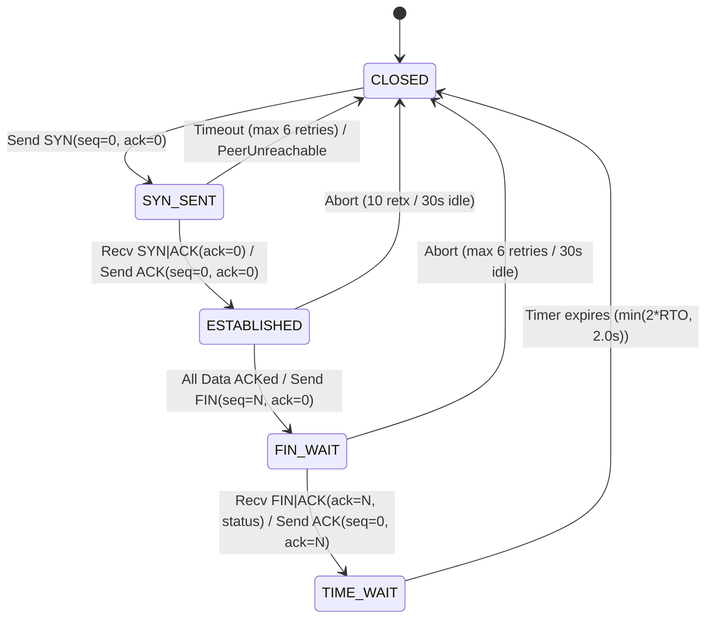
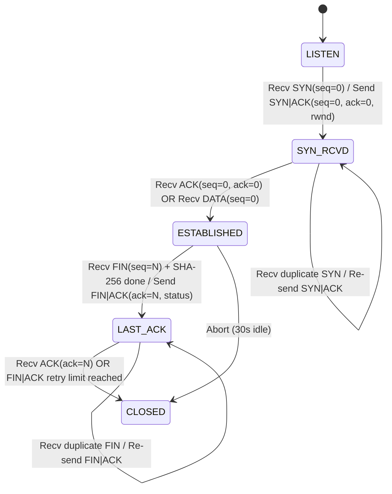

# Reliable Transport Protocol (RTP) Specification

This document provides the authoritative protocol specification for the university Computer Networks project (Project 15): Reliable Transport over UDP with Selective Repeat, Flow Control, and Congestion Control.

---

## 1. Protocol Architecture & Header Format

RTP operates directly on top of UDP datagrams. Every RTP datagram begins with an immutable **26-byte (208-bit)** header in network byte order (big-endian), followed by an optional payload of up to 1024 bytes.

### 1.1 Header Field Layout

```text
 0                   1                   2                   3
 0 1 2 3 4 5 6 7 8 9 0 1 2 3 4 5 6 7 8 9 0 1 2 3 4 5 6 7 8 9 0 1
+-+-+-+-+-+-+-+-+-+-+-+-+-+-+-+-+-+-+-+-+-+-+-+-+-+-+-+-+-+-+-+-+
|                        conn_id (32)                           |
+-+-+-+-+-+-+-+-+-+-+-+-+-+-+-+-+-+-+-+-+-+-+-+-+-+-+-+-+-+-+-+-+
|                          seq (32)                             |
+-+-+-+-+-+-+-+-+-+-+-+-+-+-+-+-+-+-+-+-+-+-+-+-+-+-+-+-+-+-+-+-+
|                          ack (32)                             |
+-+-+-+-+-+-+-+-+-+-+-+-+-+-+-+-+-+-+-+-+-+-+-+-+-+-+-+-+-+-+-+-+
|                         sack (32)                             |
+-+-+-+-+-+-+-+-+-+-+-+-+-+-+-+-+-+-+-+-+-+-+-+-+-+-+-+-+-+-+-+-+
|           rwnd (16)           |   flags (8)   |  reserved (8) |
+-+-+-+-+-+-+-+-+-+-+-+-+-+-+-+-+-+-+-+-+-+-+-+-+-+-+-+-+-+-+-+-+
|          length (16)          |            crc32 (32)         |
+-+-+-+-+-+-+-+-+-+-+-+-+-+-+-+-+-+-+-+-+-+-+-+-+-+-+-+-+-+-+-+-+
|                       crc32 (cont.)                           |
+-+-+-+-+-+-+-+-+-+-+-+-+-+-+-+-+-+-+-+-+-+-+-+-+-+-+-+-+-+-+-+-+
|                     payload (0 - 1024 bytes)                  |
+-+-+-+-+-+-+-+-+-+-+-+-+-+-+-+-+-+-+-+-+-+-+-+-+-+-+-+-+-+-+-+-+
```

### 1.2 Header Fields

| Field | Size (Bits) | Size (Bytes) | Struct Format | Description |
| :--- | :--- | :--- | :--- | :--- |
| `conn_id` | 32 | 4 | `!I` | Non-zero random 32-bit integer chosen by client on initiation. Must match across connection. |
| `seq` | 32 | 4 | `!I` | Packet sequence number (or echo of data packet sequence number in ACKs). |
| `ack` | 32 | 4 | `!I` | Cumulative acknowledgment: sequence number of next expected in-order packet. |
| `sack` | 32 | 4 | `!I` | Selective acknowledgment 32-bit bitmap: bit $i$ is set if packet `ack + 1 + i` received. |
| `rwnd` | 16 | 2 | `!H` | Receiver advertised window in packets: $\max(0, R - \text{app\_backlog})$. |
| `flags` | 8 | 1 | `!B` | Control flags bitfield (SYN, ACK, FIN, DATA, RST). |
| `reserved` | 8 | 1 | `!B` | Reserved for future alignment. Must strictly be `0x00`. Non-zero causes rejection. |
| `length` | 16 | 2 | `!H` | Length of payload in bytes ($0 \le \text{length} \le 1024$). |
| `crc32` | 32 | 4 | `!I` | CRC-32 checksum calculated over the 26-byte header (with `crc32` zeroed) plus payload. |

**Total Header Size**: 26 bytes (struct format `!IIIIHBBHI`).

### 1.3 Control Flags

Flags are encoded as a single byte bitfield:

- `FLAG_SYN` (`0x01`): Synchronize sequence numbers; initiates connection.
- `FLAG_ACK` (`0x02`): Acknowledgment field valid; acknowledges received packets.
- `FLAG_FIN` (`0x04`): Finished sending data; initiates teardown.
- `FLAG_DATA` (`0x08`): Packet contains stream payload (or zero-window probe).
- `FLAG_RST` (`0x10`): Reset connection (reserved for error aborts, not used in core protocol).

#### Valid Flag Combinations
No other combinations are allowed. Piggybacking data and ACK is explicitly forbidden:
1. `SYN` (`0x01`): Initial client connection request.
2. `SYN | ACK` (`0x03`): Server response accepting connection.
3. `ACK` (`0x02`): Handshake completion, data ACK, window probe response, or teardown ACK.
4. `DATA` (`0x08`): Data packet carrying application byte payload or zero-window probe.
5. `FIN` (`0x04`): Client initiating connection close.
6. `FIN | ACK` (`0x06`): Server confirming delivery and carrying 1-byte SHA-256 verification status.

### 1.4 Checksum Calculation & Validation
The checksum is standard CRC-32 (`zlib.crc32`).
- **Sender**: Sets `crc32 = 0` in header, packs header, concatenates payload, computes CRC-32 over `(header_zero_crc + payload) & 0xFFFFFFFF`, and inserts the calculated CRC into the header.
- **Receiver**: Unpacks header, checks length against datagram size, zeroes the CRC field, recalculates CRC-32 over header and received payload. If recalculated CRC does not match the packet's CRC, the packet is discarded silently and counted in metrics.

---

## 2. Code-Generated Hexdumps

The following hex dumps were produced directly by `rtp/packet.py` execution:

### 2.1 SYN Packet (`conn_id=0x12345678, seq=0, ack=0, sack=0, rwnd=64, flags=SYN`)
```text
0000   12 34 56 78 00 00 00 00 00 00 00 00 00 00 00 00   |.4Vx............|
0010   00 40 01 00 00 00 fe 26 89 ef                     |.@.....&..|
Raw hex: 12345678000000000000000000000000004001000000fe2689ef
```

### 2.2 DATA Packet (`conn_id=0x12345678, seq=0, ack=0, sack=0, rwnd=64, flags=DATA, payload="Hello, RTP Network!"`)
```text
0000   12 34 56 78 00 00 00 00 00 00 00 00 00 00 00 00   |.4Vx............|
0010   00 40 08 00 00 13 01 82 9f ad 48 65 6c 6c 6f 2c   |.@........Hello,|
0020   20 52 54 50 20 4e 65 74 77 6f 72 6b 21            | RTP Network!|
Raw hex: 1234567800000000000000000000000000400800001301829fad48656c6c6f2c20525450204e6574776f726b21
```

---

## 3. Sequence Number and Acknowledgment Semantics

1. **Packet-Level Numbering**: Sequence numbers count packets, not bytes.
2. **Initial Sequence Numbers**:
   - `SYN` carries `seq = 0`.
   - First `DATA` packet carries `seq = 0`.
   - `FIN` carries `seq = N` where $N$ is the total number of data packets transmitted.
3. **Acknowledgment Fields**:
   - `seq` in ACK: Echoes the exact `seq` of the DATA packet that triggered this ACK.
   - `ack` in ACK: Cumulative ACK representing the next contiguous packet expected by the receiver ($rcv\_base$). All packets with sequence numbers strictly less than `ack` have been received and buffered/delivered.
   - `sack` in ACK: 32-bit bitmap where bit $i$ ($0 \le i \le 31$, bit 0 is least significant) is 1 if packet `ack + 1 + i` has been received.
   - `rwnd` in ACK: Current available receiver buffer capacity in packets.
4. **Immediate ACKs**: The receiver ACKs every arriving DATA packet immediately without delayed ACK timers. Duplicate or out-of-order packets are immediately acknowledged with current state.
5. **No Sequence Wraparound**: A 20 MB file with 1024-byte payloads comprises ~19,532 packets. Since 32-bit sequence space supports $4,294,967,296$ packets, wraparound cannot occur for supported file transfers. Wraparound logic is omitted by design.

---

## 4. Connection State Machines

### 4.1 Client State Machine



| Current State | Event / Input | Action Taken | Next State |
| :--- | :--- | :--- | :--- |
| `CLOSED` | `connect()` called | Send `SYN(seq=0, ack=0)`, start SYN timer (1.0 s) | `SYN_SENT` |
| `SYN_SENT` | Receive `SYN|ACK` (matching `conn_id`) | Send `ACK(seq=0, ack=0)`, init RTO, send first data window | `ESTABLISHED` |
| `SYN_SENT` | SYN timer expires ($< 6$ attempts) | Retransmit `SYN`, double timeout | `SYN_SENT` |
| `SYN_SENT` | SYN timer expires ($= 6$ attempts) | Raise `PeerUnreachableError`, close connection | `CLOSED` |
| `ESTABLISHED` | All data sent & acknowledged | Send `FIN(seq=N, ack=0)`, start FIN timer | `FIN_WAIT` |
| `ESTABLISHED` | Receive duplicate `SYN|ACK` | Re-send `ACK(seq=0, ack=0)` | `ESTABLISHED` |
| `ESTABLISHED` | 10 timeouts of same packet or 30s idle | Raise `ConnectionAbortError`, cleanup | `CLOSED` |
| `FIN_WAIT` | Receive `FIN|ACK(ack=N)` | Extract status byte, send `ACK(seq=0, ack=N)`, start TIME_WAIT | `TIME_WAIT` |
| `FIN_WAIT` | FIN timer expires ($< 6$ attempts) | Retransmit `FIN`, double timeout | `FIN_WAIT` |
| `FIN_WAIT` | FIN timer expires ($= 6$ attempts) | Raise `ConnectionAbortError`, cleanup | `CLOSED` |
| `TIME_WAIT` | Receive retransmitted `FIN|ACK` | Re-send `ACK(seq=0, ack=N)`, restart TIME_WAIT timer | `TIME_WAIT` |
| `TIME_WAIT` | TIME_WAIT timer expires | Close socket, complete | `CLOSED` |

---

### 4.2 Server State Machine



| Current State | Event / Input | Action Taken | Next State |
| :--- | :--- | :--- | :--- |
| `LISTEN` | Receive `SYN(seq=0)` | Allocate connection, choose `conn_id`, send `SYN|ACK(seq=0, ack=0, rwnd)` | `SYN_RCVD` |
| `SYN_RCVD` | Receive duplicate `SYN` | Re-send `SYN|ACK` | `SYN_RCVD` |
| `SYN_RCVD` | Receive `ACK(seq=0, ack=0)` | Transition to connected; ready for data | `ESTABLISHED` |
| `SYN_RCVD` | Receive `DATA(seq=0)` | Complete handshake, process DATA seq 0, send ACK | `ESTABLISHED` |
| `ESTABLISHED` | Receive valid `DATA(seq)` | Buffer in receive window, advance contiguous prefix, send ACK | `ESTABLISHED` |
| `ESTABLISHED` | Receive zero-window probe | Send window ACK (`ack=rcv_base, rwnd=rwnd`) | `ESTABLISHED` |
| `ESTABLISHED` | Receive `FIN(seq=N)` after all data received | Verify SHA-256, set status byte, send `FIN|ACK(ack=N, status)` | `LAST_ACK` |
| `LAST_ACK` | Receive `ACK(ack=N)` | Close connection cleanly | `CLOSED` |
| `LAST_ACK` | Receive duplicate `FIN` | Re-send `FIN|ACK(ack=N, status)` | `LAST_ACK` |
| `LAST_ACK` | Retransmission limit / 30s idle | Close connection | `CLOSED` |

---

## 5. Timers and Timing Rules

All timers operate on `time.monotonic()` in the single-threaded `select()` event loop:

1. **RFC 6298 Adaptive RTO**:
   - Initial RTO: $1.0\text{ s}$.
   - Clamped bounds: $[0.2\text{ s}, 60.0\text{ s}]$. (Note: $200\text{ ms}$ minimum is a deliberate deviation from RFC 6298's $1.0\text{ s}$).
   - Smoothing parameters: $\alpha = 1/8$, $\beta = 1/4$, $K = 4$, clock granularity $G = 1\text{ ms}$.
   - First RTT sample $R$:
     $$SRTT = R, \quad RTTVAR = R / 2, \quad RTO = SRTT + \max(G, 4 \times RTTVAR)$$
   - Subsequent samples $R$:
     $$RTTVAR = (1 - \beta) \times RTTVAR + \beta \times |SRTT - R|$$
     $$SRTT = (1 - \alpha) \times SRTT + \alpha \times R$$
     $$RTO = \text{clamp}(SRTT + \max(G, 4 \times RTTVAR), 0.2, 60.0)$$
   - **Karn's Rule**: RTT samples are gathered only from packets that were transmitted exactly once (never retransmitted).
   - **Loss Epoch Gating**: An epoch starts on a timeout and ends when `send_base` advances past the highest packet sent at timeout time. At most one RTO backoff and one cwnd reduction per loss epoch.
2. **Persist Timer (Zero-Window Probing)**:
   - Armed when $rwnd == 0$. Initial duration = current RTO.
   - Exponential backoff on expiry, capped at $2.0\text{ s}$.
   - Transmits a 0-length DATA probe with $seq = send\_next$.
3. **TIME_WAIT Timer**:
   - Set to $\min(2 \times RTO, 2.0\text{ s})$ upon sending ACK to `FIN|ACK`.
4. **Idle Inactivity Timer**:
   - Connection aborts if no valid packet is received for $30.0\text{ s}$.

---

## 6. Invalid Packet Handling Rules

Any incoming packet meeting any of the following conditions is **discarded silently and counted in metrics**:
1. Raw datagram length $< 26$ bytes (`PacketTruncatedError`).
2. Header `length` field does not match the actual received payload length (`PacketLengthMismatchError`).
3. Header `length` field $> 1024$ bytes (`PacketPayloadTooLargeError`).
4. Header `reserved` byte $\ne 0$ (`PacketReservedNonZeroError`).
5. Invalid flags combination (`PacketInvalidFlagsError`).
6. CRC-32 checksum mismatch (`PacketCRCError`).
7. `conn_id` mismatch on an established connection.
8. Packets received outside the valid sliding window or unexpected in the current state (ignored or re-ACKed per state machine rules).

---

## 7. Resolved Ambiguities

During project initialization, four specific architectural items were clarified and approved:

1. **SYN and Handshake Sequence Numbering**:
   - `SYN`, `SYN|ACK`, and the client's final handshake `ACK` all carry `seq = 0, ack = 0`.
   - The first `DATA` packet carries `seq = 0`, and the receiver's resulting acknowledgment carries `ack = 1`.
   - `FIN` carries `seq = N` (where $N$ is the total count of data packets in the stream). `FIN|ACK` and the client's final teardown `ACK` carry `ack = N`. `SYN|ACK` carries the server's initial `rwnd`.
2. **Piggybacking**:
   - No piggybacking is permitted.
   - Data packets use flags `DATA` only (`0x08`).
   - Acknowledgment packets use `ACK` (`0x02`), `SYN|ACK` (`0x03`), or `FIN|ACK` (`0x06`).
3. **Zero-Window Probe Mechanics**:
   - The probe packet carries flags `DATA` (`0x08`), `length = 0`, and `seq = send_next` (the next never-sent sequence number).
   - The receiver identifies a probe by `length == 0` on a packet with `flags == DATA`, regardless of `seq`. The receiver must not buffer it, deliver it, advance `rcv_base`, or treat it as duplicate data. It immediately replies with an `ACK` carrying current `ack = rcv_base` and `rwnd`.
   - The sender marks a packet as `ACKED` from an ACK's echoed `seq` field **only** if that sequence number is currently `IN_FLIGHT`. Echoes for `UNSENT` or already `ACKED` packets are ignored, and zero-window probes never generate RTT samples.
4. **SACK Bitmap Coverage vs. Window Size**:
   - The 32-bit `sack` bitmap covers sequence numbers `[ack + 1, ack + 32]`.
   - Packets arriving beyond `ack + 32` up to `max_window` (64) remain buffered in the receiver's window but are not reflected in the bitmap until `ack` advances. Correctness is fully preserved because per-packet ACKs and timeouts provide independent delivery guarantees.
